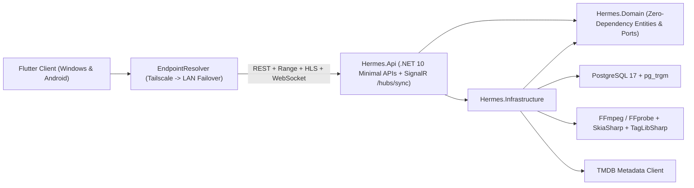

# Hermes Media Server

[](https://github.com/RobertCDR/hermes-media-server/actions/workflows/ci-backend.yml)
[](https://github.com/RobertCDR/hermes-media-server/actions/workflows/ci-client.yml)
[](https://github.com/RobertCDR/hermes-media-server/actions/workflows/docker.yml)
[](https://github.com/RobertCDR/hermes-media-server/actions/workflows/security.yml)

**Hermes Media Server** is a self-hosted **Cinema & Music** streaming platform built from scratch using **.NET 10 LTS**, **PostgreSQL 17**, **FFmpeg**, **SignalR v2**, and a native GPU-accelerated **Flutter** client for Windows and Android.

It unifies multi-version movie and TV series playback (with HDR-safe subtitle rendering and adaptive HLS transcoding) alongside a Spotify-style dual-mode music world with cross-device Connect state synchronization.

---

## System Architecture



For an in-depth breakdown of assemblies, PostgreSQL schema, SignalR Connect semantics, and client modules, see [docs/ARCHITECTURE.md](docs/ARCHITECTURE.md).

---

## Core Engineering Highlights

### Backend (Pragmatic DDD + Vertical Slice Architecture)
- **Strict Dependency Rule (`NetArchTest.Rules`)**: `Hermes.Domain` has **zero NuGet dependencies** and defines rich aggregates (`Movie`, `MediaSource`, `Episode`, `Song`, `PlaybackSession`, `User`) plus explicit `Ports/` interfaces (`IPasswordHasher`, `ITokenService`, `IStreamTicketService`, `ITranscodeSessionManager`, `IDevicePresenceRegistry`, `IMediaProbeService`, `IArtworkStore`).
- **Vertical Slice API (`Hermes.Api`)**: Features organized cleanly under `Features/{Setup,Auth,Admin,Cinema,Music,Streaming,System}` and `Hubs/PlaybackSyncHub.cs` using .NET 10 Minimal APIs.
- **PostgreSQL 17 Persistence & `pg_trgm` Unified Search**: Normalized EF Core 10 schema with migrations, per-user watch progress enforcing a 90% auto-watched invariant, and unified fuzzy search across Movies, Series, Artists, Albums, and Songs (`/api/v1/search?q=...`).
- **On-Demand FFmpeg Pipeline & Bounded Slot Governance**:
  - Byte-range `DirectPlay` (`/api/v1/streams/{id}/direct`) for native client decoding.
  - Adaptive HLS video transcoding (`DirectPlay`, `1080p`, `720p`, `480p`) governed by `FfmpegTranscodeSessionManager` with concurrent transcode slot limits (`429 transcode_slots_exhausted`) and instant segment directory cleanup.
  - Spotify-style audio bitrate tiers (`Lossless`, `VeryHigh320`, `High160`, `Medium96`, `Low64`) with **zero-upscale protection** (automatically falls back to `DirectPlay` when source bitrate is already at or below target).
  - External `.srt` / `.vtt` conversion and embedded text-subtitle extraction into normalized `WEBVTT` (`/api/v1/streams/{id}/subtitles/{index}.vtt`).
  - Pre-resized `SkiaSharp` WebP artwork thumbnails (`thumb` / `poster`) stored cleanly by SHA-256 content hash.

### Cross-Platform Flutter Client (`Windows` & `Android`)
- **Obsidian Crimson Token Theme (`HermesThemeTokens`)**: Dark cinema-first aesthetic (`Obsidian Glow` `#090B12` primary, `#111522` elevated, Crimson `#E11D48` accent) with selectable `OLED Black` (`#000000`) and `Slate` (`#0F172A`) surface presets, multi-accent options, and **Dynamic Album Art** clamping.
- **Multi-Source Selector & OpenGL HDR-Safe Subtitles**:
  - `SourceSelectorCard` lets you pick between multiple releases per title (`1080p`, `4K HDR10`, codec, bitrate, audio tracks, subtitle tracks) and target video quality (`DirectPlay` -> `480p`).
  - `HermesVideoPlayerConfig.hdrSafeDefault` configures `gpu-api=opengl` and clamps subtitle text to `#D8D8D8` over `#80000000` to prevent SDR subtitle luminance blooming on HDR monitors.
- **Spotify-Style Connect Coordinator (`MusicPlaybackCoordinator`)**:
  - Monotonic `Version` state synchronization (`SessionStateUpdated`) prevents stale WebSocket messages from overwriting newer state.
  - Strictly separates the **active audio renderer** (`ActiveRendererDeviceId`) from remote controllers: phones can control desktop playback without stealing audio output unless an explicit `TransferOutput` occurs.
  - Disconnecting an active renderer automatically pauses playback across the user's connected devices.
  - Network-aware audio quality policy (`Wi-Fi`: default `Lossless`, `Cellular`: default `High160`) and `PlatformMediaBridge` OS media transport hooks.
- **Resilient Networking**: `EndpointResolver` probes your Tailscale primary URL first (1.5s timeout) and seamlessly fails over to your local LAN fallback URL if the `serverId` matches.

---

## Quickstart (Docker Compose)

1. Configure environment secrets:
   ```bash
   cp deploy/.env.example deploy/.env
   ```
   Edit `deploy/.env` and provide strong secrets for `POSTGRES_PASSWORD`, `HERMES_JWT_SECRET` (min 32 characters), `HERMES_STREAM_TICKET_SECRET` (min 32 characters), and set `HERMES_MEDIA_PATH` to your read-only host media directory.

2. Start PostgreSQL 17 and `hermes-api` under the `hermes` Docker Compose stack:
   ```bash
   docker compose --env-file deploy/.env -f deploy/docker-compose.yml up -d --build
   ```

3. Verify server health and complete first-run setup:
   - Health check: `GET http://localhost:5258/health/live`
   - Server info: `GET http://localhost:5258/api/v1/system/info`
   - Open the Flutter client (`flutter run -d edge` or Windows/Android), enter `http://localhost:5258` (or your Tailscale URL + LAN fallback), create the admin account on first launch, and add your `/media/...` library roots from the Admin Dashboard.
   - Or launch directly in **Visual Studio 2026** (`backend/Hermes.slnx` with `launchSettings.json` profiles) or **VS Code** (`.vscode/launch.json`). See [docs/DEPLOYMENT.md](docs/DEPLOYMENT.md).

---

## Local Development & Verification

### Prerequisites
- [.NET 10 SDK](global.json) (`10.0.401`)
- Docker (for PostgreSQL 17 integration tests via Testcontainers)
- `ffmpeg` and `ffprobe` on `PATH`
- Flutter `3.50.0` (Dart `3.14.0`)

### Backend Build, Test, Coverage & Audit
```bash
dotnet test backend/Hermes.slnx --configuration Release --verbosity minimal --collect:"XPlat Code Coverage" --settings backend/coverlet.runsettings --results-directory backend/TestResults
dotnet list backend/Hermes.slnx package --vulnerable --include-transitive
```

### Flutter Client Analysis, Tests & Coverage
```bash
cd client
flutter pub get
flutter analyze --fatal-infos
flutter test --coverage
```

---

## Documentation

- [Architecture Guide](docs/ARCHITECTURE.md) — DDD layers, PostgreSQL schema, FFmpeg/SignalR flows, Flutter client architecture
- [API Reference](docs/API.md) — Complete REST endpoint contracts, DTO shapes, and SignalR `/hubs/sync` real-time protocol
- [Deployment & IDE Setup](docs/DEPLOYMENT.md) — Docker Compose `hermes` stack, `.env` secrets, Visual Studio 2026 & VS Code launch profiles, Tailscale/reverse-proxy configuration
- [Flutter Client Guide](client/README.md) — Client module structure, theme presets, Connect coordinator, Web/Windows/Android build instructions
- [Security Overview](docs/SECURITY.md) — Authentication, cryptographic primitives, stream tickets, process isolation, CI checks
- [Contributing Guide](docs/CONTRIBUTING.md) — Coding standards, TDD workflow, PR template checklist
- [Design Specification](docs/specs/2026-11-15-hermes-media-server-design.md) — Complete system design document
