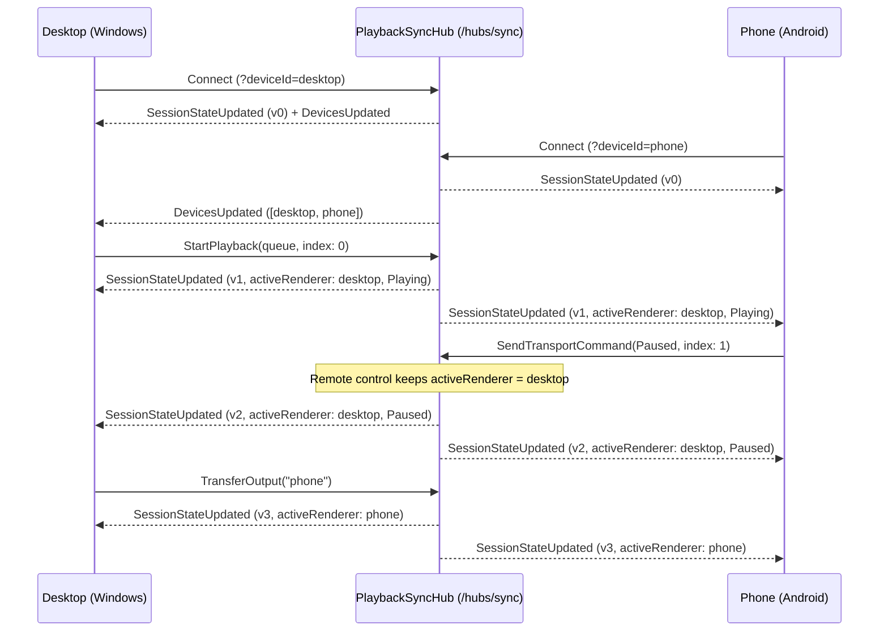

# Architecture Guide

Hermes Media Server separates **backend domain invariants**, **infrastructure adapters**, **HTTP/SignalR vertical slices**, and **client presentation/playback coordinators** into strict architectural boundaries verified automatically in CI.

---

## 1. Backend Topology (`backend/`)

| Assembly | Responsibility | Dependency Rules |
| :--- | :--- | :--- |
| `Hermes.Domain` | Core entities (`User`, `DeviceRefreshToken`, `InviteCode`, `MediaLibraryRoot`, `Movie`, `TvSeries`, `Episode`, `MediaSource`, `MediaStream`, `WatchProgress`, `Artist`, `Album`, `Song`, `Playlist`, `PlaybackSession`), enums (`MediaEnums.cs`), and port interfaces (`DomainPorts.cs`). | **Zero NuGet dependencies** (enforced by `NetArchTest.Rules` in `Hermes.UnitTests`). |
| `Hermes.Infrastructure` | PostgreSQL 17 `HermesDbContext` + EF Core migrations (`pg_trgm`), `LibraryScannerService` & `LibraryScanWorker`, `FfprobeMediaProbeService`, `FfmpegTranscodeSessionManager`, `SubtitleExtractorService`, `TagLibAudioMetadataReader`, `SkiaArtworkStore`, `TmdbMetadataClient`, `InMemoryDevicePresenceRegistry`, `PasswordHasherAdapter`, `JwtTokenService`, `HmacStreamTicketService`. | References `Hermes.Domain` only. |
| `Hermes.Api` | Thin composition root (`Program.cs`), Minimal API feature slices (`Features/*`), SignalR hub (`Hubs/PlaybackSyncHub.cs`), and `PlaybackConnectService`. | References `Hermes.Domain` and `Hermes.Infrastructure`. |

---

## 2. Database & Search (`PostgreSQL 17`)

- **Normalized Media Graph**:
  - **Cinema**: `MediaLibraryRoot` -> `Movie` / (`TvSeries` -> `Episode`) -> `MediaSource` (one title can have multiple video files/qualities) -> `MediaStream` (video, audio, subtitle indices and codecs).
  - **Music**: `MediaLibraryRoot` -> `Artist` -> `Album` -> `Song`, plus `Playlist`, `PlaylistItem`, and `UserLikedSong`.
  - **Progress & Sessions**: `WatchProgress` tracks per-user movie/episode position and enforces a **90% completion threshold** (`IsWatched = true` once `PositionMs / DurationMs >= 0.90`). `PlaybackSession` stores persisted Connect queue state and monotonic `Version`.
- **Unified Search (`/api/v1/search?q=...`)**:
  - Uses PostgreSQL trigram indexing (`pg_trgm`) and `ILIKE` matching to search across `Movies`, `TvSeries`, `Artists`, `Albums`, and `Songs` in a single round-trip.

---

## 3. Media Scanning, Artwork & Streaming Pipeline

1. **Background & On-Demand Scanning (`LibraryScannerService`, `LibraryScanChannel`, `LibraryScanWorker`)**:
   - Discovers video (`.mkv`, `.mp4`, `.avi`, `.mov`, `.m4v`, `.webm`, `.ts`) and audio (`.flac`, `.mp3`, `.m4a`, `.ogg`, `.wav`, `.opus`) files while skipping `extras`/`trailers`/`sample` folders.
   - Extracts container/codec/HDR metadata with `FfprobeMediaProbeService`, ID3/FLAC/Vorbis tags and embedded cover art with `TagLibAudioMetadataReader`, and optional external metadata via `TmdbMetadataClient`.
   - Processes images with `SkiaArtworkStore` into deduplicated SHA-256 content-addressed WebP variants.
2. **Video & Audio Streaming (`StreamEndpoints.cs`, `FfmpegTranscodeSessionManager.cs`)**:
   - **DirectPlay (`/api/v1/streams/{sourceId}/direct`)**: HTTP Range `206 Partial Content` streaming directly from disk.
   - **Adaptive HLS Video (`/api/v1/streams/{sourceId}/video/master.m3u8`)**: On-demand H.264/AAC HLS segmentation (`1080p`, `720p`, `480p`) bounded by configurable concurrent slot limits (`transcode_slots_exhausted` HTTP 429 when saturated) and deterministic session directory cleanup (`DELETE .../hls/{sessionId}`).
   - **Audio Tiers (`/api/v1/streams/{songId}/audio`)**: Supports `Lossless`, `VeryHigh320`, `High160`, `Medium96`, and `Low64`. If the file's bitrate is less than or equal to the requested bitrate, `StreamEndpoints` bypasses transcoding and serves `X-Hermes-Delivery: DirectPlay` without upscaling; otherwise FFmpeg encodes on the fly (`X-Hermes-Delivery: Transcoded`).
   - **Subtitles (`/api/v1/streams/{sourceId}/subtitles/{index}.vtt`)**: Serves sidecar `.srt`/`.vtt` files or extracts internal text subtitle tracks as normalized `WEBVTT`.

---

## 4. SignalR v2 Connect Synchronization (`/hubs/sync`)

`PlaybackSyncHub` + `PlaybackConnectService` + `InMemoryDevicePresenceRegistry` coordinate multi-device playback per authenticated user:

Key invariants:
- Every session mutation increments a monotonic `Version` serialized per user via `PlaybackSessionLockProvider`.
- Remote control commands never steal `ActiveRendererDeviceId`.
- If the active renderer disconnects without transferring output, `OnDisconnectedAsync` triggers `HandleDisconnectAsync` to pause the session and clear `ActiveRendererDeviceId`.

---

## 5. Flutter Client Architecture (`client/lib/`)

| Module | Path | Role |
| :--- | :--- | :--- |
| Theme Tokens | `src/core/theme/hermes_theme_tokens.dart` | `HermesThemeTokens` (`Obsidian Glow`, `OLED Black`, `Slate` surfaces + `Crimson` and selectable accents + `#D8D8D8` HDR-safe subtitles). |
| Networking | `src/core/network/endpoint_resolver.dart` | Primary Tailscale -> LAN fallback probe (`1500ms` timeout) verified against `serverId`. |
| Auth & Session | `src/core/auth/` | Token storage, login/setup/invite flows, bearer header & refresh handling. |
| Dual-World Shell | `src/features/shell/dual_world_shell.dart` | Persistent switcher between **Cinema** and **Music** worlds plus Admin/Settings entry points. |
| Cinema World | `src/features/cinema/` | `CinemaCatalogScreen`, `SourceSelectorCard` (multi-release & quality selector), `HermesVideoPlayerConfig` (`gpu-api=opengl`, `#D8D8D8` subtitles), `WatchProgressReporter`. |
| Music World & Connect | `src/features/music/` | `MusicWorldScreen`, `MusicPlaybackCoordinator` (monotonic version guard + Wi-Fi/Cellular quality policy), `DevicePickerSheet`, `MiniPlayerBar`, `PlatformMediaBridge`. |
| Admin & Settings | `src/features/admin/`, `src/features/settings/` | Library root registration, manual scan triggers, invite generation, theme & HDR player configuration. |
