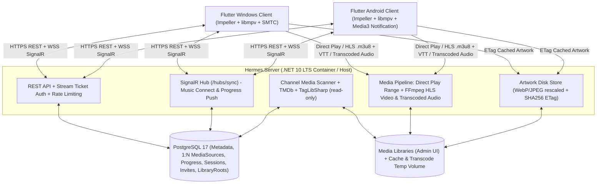

# Hermes Media Server — Document de Design Tehnic

**Data:** 2026-11-15  
**Stare:** Completat după Builder Check — pregătit pentru aprobare  
**Locație țintă la inițializarea repo-ului:** `<repo-root>` *(folder fără spații pentru compatibilitate Flutter/Android NDK/Gradle; nume produs: **Hermes Media Server**)*  
**Destinație spec în repo:** `docs/specs/2026-11-15-hermes-media-server-design.md`

---

## 1. Intenție & Motivație

**Hermes Media Server** reinventează fostul prototip de licență (`<legacy-prototype-repo>`) — afectat de secrete comise în Git, BLOB-uri binare în EF Core, full-table scans în RAM, lipsă redare video nativă, sync cross-device instabil și cod MAUI duplicat — într-un **produs personal real, intuitiv și enterprise-grade**, construit curat într-un repository public nou pe GitHub.

### Obiective (Goals)
1. **Media Hub personal all-in-one (`Dual-World Hub: Cinema | Music`):**
   * **Cinema (stil Stremio / Nuvio):** catalog cu metadate TMDb + fallback local, *Continue Watching*, progres sincronizat cross-device, episoade/sezoane cu Next Episode automat, model multi-sursă per titlu (`1:N MediaSources` cu selector stil Stremio/Torrentio și bază extensibilă pentru addon-uri viitoare), selector de calitate tip YouTube, selector piste audio/subtitrări și **redare video nativă direct în aplicație** (inclusiv profil dedicat HDR/OpenGL pentru monitoare HDR).
   * **Muzică (Spotify de-bloated):** bibliotecă rapidă, artiști/albume, melodii apreciate, playlist-uri personale, coadă live, Spotify Connect (*telecomandă implicită + transfer explicit pe dispozitiv*), selector de calitate audio stil Spotify (`Lossless` / `Very High` / `High` / `Medium` / `Low`) și redare în fundal nativă (`MediaSession` pe Android, `SMTC` pe Windows).
2. **Acces sigur LAN / Tailscale / Internet pentru prieteni:** server self-hosted via `docker compose` (PostgreSQL + API + FFmpeg), onboarding Admin, coduri de invitație, stream tickets efemere semnate și comutare transparentă între URL local LAN și URL remote fără re-login.
3. **Showcase Enterprise & Practici de Echipă:** `.NET 10 LTS`, PostgreSQL, CI/CD GitHub Actions, analiză statică strictă, testare automată la fiecare PR (unit, `Testcontainers.PostgreSql`, multi-client `SignalR`, widget tests) și livrare prin PR-uri verticale mici cu commit-uri convenționale.

### Non-Obiective & Anti-Obiective (v1)
* **NU browser tab glorificat:** zero Electron, WebView sau Blazor Hybrid; client nativ randat pe GPU.
* **NU funcții sociale în v1:** fără playlist-uri publice/colaborative sau feed-uri sociale — focus exclusiv pe media server pur, modularizat curat pentru extinderi ulterioare.
* **NU restricții per-utilizator pe biblioteci în v1:** orice utilizator `Member` autentificat are acces universal la toate bibliotecile activate.
* **NU migrare DB veche:** pornire 100% curată pe PostgreSQL + re-scanare din media folder (ex. fișierele de test din `<local-media-folder>` adăugate de Admin din UI).
* **NU lansare/omorâre procese `vlc.exe` pe server** și **NU telecomandă video live / Watch Party** în v1 (doar sync de Watch Progress / Continue Watching pe Video).
* **NU scriere în fișierele audio ale utilizatorului:** scanner-ul este **strict read-only**.
* **NU customizare granulară haotică pe fiecare element UI:** personalizare curată bazată pe token-uri semantice și preset-uri.

---

## 2. Constrângeri

* **Repo vechi neatins:** `<legacy-prototype-repo>` rămâne arhivă privată de licență nemodificată.
* **Organizare workspace la execuție:** crearea `Desktop\Projects\` și mutarea repo-urilor existente (`ASET`, `eye tracker`) alături de `hermes-media-server` se va executa controlat după faza de planificare, folosind un nume de folder fără spații pentru noul proiect.
* **Zero secrete sau căi personale în Git:** nicio cheie TMDb, niciun secret JWT, niciun path local (`<local-media-folder>`), IP sau serial hardware nu intră în codebase. Vechea cheie TMDb expusă în repo-ul de licență trebuie revocată de proprietar.
* **Platforme țintă v1:** Backend `.NET 10 LTS` + Client Flutter pentru **Windows Desktop** și **Android Mobil** (pregătit arhitectural pentru extindere ulterioară spre Android TV / Linux / macOS).
* **Tooling:** `.NET SDK 10.0.401+` (VS 2026 / VS Code / CLI — VS 2022 nu suportă nativ `.NET 10`), `Flutter SDK`, `Docker` + `PostgreSQL 17`, `FFmpeg`/`FFprobe`.

---

## 3. Abordări Analizate (Approaches)

După eliminarea WebView/Electron și a codului MAUI fragmentat, au fost comparate 3 variante peste backend `.NET 10 LTS + PostgreSQL`:

| Variantă | Stack Client | Avantaje | Trade-off-uri | Verdict |
| :--- | :--- | :--- | :--- | :--- |
| **1. Flutter + `media_kit` (`libmpv`)** *(Ales)* | Dart + Impeller/Skia nativ + `media_kit` + `audio_service` / Windows SMTC | Stack consacrat de *Fladder* / *Nuvio* / *Spotube*. Randare GPU nativă; video ca textură (zero airspace peste OSD/subtitrări); control direct `libmpv` (inclusiv renderer `OpenGL` și dimmed HDR subtitles); MKV/H.265/ASS out-of-the-box; 1 codebase Win + Android. | Stack bilingv (C# backend + Dart client); necesită `mimalloc`/cap buffer pe Windows + bridge SMTC. | **Ales** |
| **2. Avalonia UI 12 (`.NET 10`)** | C# full-stack + `LibVLCSharp` (Win) + `ExoPlayer` nativ (Android) | Un singur limbaj C#. | MediaPlayer oficial cere licență comercială Pro; `LibVLCSharp` pe Windows suferă de **HWND airspace** peste OSD; fără background media notification nativ out-of-the-box pe Android. | Respins |
| **3. Nativ separat (`Compose + WinUI 3`)** | Kotlin + Jetpack Compose + Media3 (Android) & WinUI 3 (Windows) | Integrare nativă maximă per OS. | Dublează efortul de UI, cache și sync pe două baze de cod și limbaje complet diferite. | Respins |

---

## 4. Arhitectura Sistemului & Design Detaliat

### 4.1 Topologie de ansamblu

### 4.2 Structura Monorepo Nou (`hermes-media-server`)
* `backend/`: `Hermes.slnx`, `Directory.Build.props` (`net10.0`, `Nullable=enable`, `TreatWarningsAsErrors=true`, `NuGetAudit=true`), `Directory.Packages.props` (Central Package Management), `.editorconfig`, **`src/Hermes.{Domain,Infrastructure,Api}` (Pragmatic DDD în `Domain` + `Ports/`, adaptoare în `Infrastructure` și Vertical Slices `Features/` în `Api`, fără stratul redundant `Application`)** + `tests/Hermes.{UnitTests,IntegrationTests}` (`NetArchTest.Rules`, `Testcontainers.PostgreSql` + `WebApplicationFactory` + multi-client `HubConnection` sync tests). Fără `AutoMapper` și fără `GenericRepository<T>`.
* `client/`: proiect Flutter modular (`lib/core`, `lib/features/{auth,cinema,music,player,settings,admin}`, `test/`, `analysis_options.yaml` strict).
* `deploy/`: `Dockerfile` multi-stage cu `ffmpeg` și user non-root, `docker-compose.yml` (`hermes-api` + `postgres:17-alpine` + volume persistente), `.env.example`, `appsettings.Example.json`.
* `.github/workflows/`: `ci-backend.yml`, `ci-client.yml`, `security.yml` (`dotnet list package --vulnerable`, Gitleaks, CodeQL), `docker.yml`.

### 4.3 Securitate, Onboarding, Acces Prieteni & Multi-Endpoint Client
1. **First-Run Setup & Invite Codes:**
   * Dacă nu există niciun utilizator, `/api/v1/setup` permite crearea primului cont `Admin`, apoi se dezactivează permanent (`403/410`).
   * Adminul generează coduri de invitație (cu expirare și număr maxim de utilizări) pentru prieteni (`Member`). Înregistrarea publică deschisă este dezactivată implicit.
2. **RBAC & Acces Universal pe Biblioteci:**
   * `Admin`: configurează `MediaLibraryRoots`, declanșează scanări, folosește „Identify / Fix Match”, generează invitații, dezactivează/șterge conturi, generează coduri de reset parolă (fără SMTP) și setează limitele de streaming (`ServerSettings`).
   * `Member`: acces universal la toate bibliotecile active, propriul watchlist, progres video, playlist-uri și favorite personale. **Zero acces** la operațiuni pe sistemul de fișiere al serverului.
   * DTO-urile nu expun niciodată email-uri altor utilizatori; toate endpoint-urile în afara auth/setup/health cer `[Authorize]`.
3. **Autentificare Multi-Device, Multi-Endpoint & Stream Tickets:**
   * `RefreshToken` stocat per `(UserId, DeviceId, DeviceName)` — login-ul pe telefon nu deconectează PC-ul; toate sesiunile unui user se revocă la `ChangePassword`.
   * Clientul stochează token-urile exclusiv în `flutter_secure_storage` și suportă configurarea unui **URL Principal (Remote HTTPS)** + **URL Local LAN opțional** pentru același `ServerId` (verificat prin endpoint-ul ușor `/api/v1/system/info`), comutând automat între Wi-Fi acasă și 4G fără re-login sau invalidarea cache-ului de imagini.
   * Media stream, HLS playlists/segments, subtitrări și artwork folosesc **Stream Tickets efemere** semnate HMAC-SHA256 (`5 minute` TTL pentru media / ticket per sesiune HLS) — **niciodată JWT-ul principal în query string**.
   * Rate limiting nativ ASP.NET Core pe auth/setup/tickets; Android `allowBackup="false"` și avertisment vizual dacă clientul se conectează prin HTTP simplu pe un endpoint non-LAN.

### 4.4 Baza de Date PostgreSQL & Artwork Store
* **Migrații reale:** aplicare controlată prin `Database.MigrateAsync()` / migrator dedicat (zero `EnsureCreatedAsync`).
* **Model 1:N `MediaSource` stil Stremio/Nuvio:**
  * `Movie` și `Episode` dețin metadatele canonice (titlu, an, descriere, TMDbId, `ArtworkHash`, `BackdropHash`, `IsMetadataLocked`), iar tabela copil `MediaSources` stochează unul sau mai multe fișiere asociate (`FilePath`, `Container`, `VideoCodec`, `AudioCodec`, `Width`, `Height`, `IsHdr`, `BitrateBps`, `FileSizeBytes`, `SourceLabel` ex. `1080p HEVC`, `MissingSince`) + `MediaStreams` (benzi audio & subtitrări detectate cu `ffprobe`).
  * `WatchProgress` este atașat la `Movie`/`Episode` (astfel dacă ai și `1080p` și `4K` pentru același film, progresul rămâne comun, exact ca la Stremio!).
* **Zero `byte[]` BLOBs în SQL:** copertele/posterele/backdrops sunt procesate la scanare cu `SkiaSharp` în dimensiuni fixe pe disk/volum (`thumb_400.webp`, `poster_800.webp`, `backdrop_1280.webp`) și servite cu `Cache-Control` + `ETag` (`304 Not Modified`).
* **Search 100% în PostgreSQL:** indecși `GIN`/`pg_trgm`, proiecții directe `.Select(...)`, zero full-table `.ToListAsync()` în RAM și **zero apeluri concurente `Task.WhenAll` pe același `DbContext` Scoped**.

### 4.5 Admin Library Roots, Scanner, TMDb Identify & Pipeline Transcodare FFmpeg
* **Library Roots & Scanner `Channel<T>`:**
  * Foldere configurate de Admin în UI (`Movies`, `Series`, `Music`, toggle FileWatcher). Verifică **întâi** în DB `(FilePath, FileSizeBytes, LastWriteUtc)` înainte de `ffprobe`, `TagLibSharp` (read-only în `using`) sau HTTP TMDb. Ignoră subfoldere auxiliare (`Extras`, `Trailers`, `Sample`).
  * **Identify / Fix Match:** din pagina de detalii a unui film/serial, Adminul poate căuta manual pe TMDb și re-asocia titlul + artwork-ul (blocând `IsMetadataLocked = true` ca scanările viitoare să nu suprascrie alegerea).
* **Video Streaming (Selector calitate stil YouTube):**
  * Trepte disponibile în player: **`Direct Play (Original)`**, **`1080p` (8 Mbps)**, **`720p` (4 Mbps)**, **`480p` (1.5 Mbps)**.
  * *Direct Play:* HTTP Range `PhysicalFile` (0% CPU, 4K/HDR/PGS/VobSub/ASS redate nativ de `libmpv`).
  * *Transcodare On-Demand HLS (FFmpeg):* `TranscodeSessionManager` pornește HLS seekable (`libx264` + `aac` stereofonic, în limita sloturilor concurente setate de Admin) cu segmente temporare curățate automat prin LRU. Subtitrările text (`.srt`, `.ass`, `.vtt` externe sau embedded) sunt servite ca `.vtt`; la schimbarea pistei audio în mod transcode HLS, sesiunea reia de la timestamp-ul curent pe pista aleasă.
* **Audio Streaming (Selector calitate stil Spotify):**
  * Trepte configurabile separat pentru **Wi-Fi** și **Date Mobile / Remote**: **`Lossless (Original / Direct Play)`**, **`Very High (~320 kbps)`**, **`High (~160 kbps)`**, **`Medium (~96 kbps)`**, **`Low (~64 kbps)`**.
  * **Regulă smart anti-risipă (zero upscale):** dacă fișierul original are deja bitrate <= ținta selectată (ex. MP3 192 kbps când ai ales *Very High 320*), serverul face **Direct Play** fără FFmpeg. FFmpeg transcodează audio (`Opus` / `AAC`) doar când sursa depășește ținta (ex. FLAC lossless ascultat pe *High 160* peste 4G).

### 4.6 Sincronizare Cross-Device — Model A (Deterministă)
1. **Cinema (`WatchProgress`):** heartbeat la ~10s + imediat la Pause/Seek/Stop; serverul notifică grupul utilizatorului prin SignalR (`WatchProgressUpdated`) -> rândul *Continue Watching* se actualizează live pe toate dispozitivele conectate.
2. **Muzică (Spotify Connect cu `Version` monotonic):**
   * Serverul menține în `PlaybackService` (sursă unică pentru REST și `PlaybackHub`) `long Version` incrementat atomic la orice mutație + registrul dispozitivelor online conectate la SignalR (pe Android menținut activ cât timp rulează `audio_service`).
   * **Mod Telecomandă Implicit:** dacă Dispozitivul A este `ActiveRendererDeviceId` și utilizatorul apasă Play/Pause/Seek/Skip/ChangeTrack de pe Dispozitivul B, serverul actualizează sesiunea și transmite comanda către A — audio rămâne pe A până când utilizatorul apasă explicit **„Transfer to this device”** în Device Picker. Dacă renderer-ul activ se deconectează complet, sesiunea rămâne în pauză în DB pentru resume ulterior.
   * **Client Unic Coordinator:** un singur `MusicPlaybackCoordinator` deține conexiunea SignalR (protejată cu `SemaphoreSlim` + backoff reconnect) și ignoră orice mesaj cu `Version <= _lastAppliedVersion`. Zero subscriberi dubli, zero bucle de `Seek()`.

### 4.7 UI/UX Client (`Flutter` — Dual-World Hub, Customizare Token & Fix HDR Subtitles)
* **Dual-World Hub (`Cinema | Music`):** switch clar în top bar între cele două lumi curate:
  * **Cinema:** layout stil Stremio/Nuvio (Hero backdrop mare, *Continue Watching*, *Movies*, *Series*, *Watchlist*, pagină de detalii cu lista de **Surse / Rezoluții** disponibile + selector sezon/episoade + *Identify* pentru Admin; Video Player cu OSD GPU translucid fără airspace, selector calitate tip YouTube, subtitrări/audio, *Next Episode* auto-countdown).
  * **Music:** experiență Spotify minimală fără zgomot (Home, Search, Artists/Albums, Liked Songs, Playlists, Queue panel/sheet, Device Picker pentru telecomandă/handoff, selector calitate Spotify-style în Settings, mini-player persistent jos activ doar când redai muzică și pus pe pauză automat dacă pornești un film).
* **Customizare Token-Based (`HermesThemeTokens`):**
  * Preset implicit: **`Obsidian Glow + Accent Crimson`**.
  * Preset-uri alese de user: **Suprafață** (`Obsidian Glow` / `OLED Black` / `Slate`) + **Accent** (paletă curată de 6 culori cu **Crimson** default) + toggle *Ambient Artwork Glow* + *Default Start World* (`Cinema`/`Music`) + *Home Row Order & Visibility* + *Card Density* (`Compact`/`Comfortable`).
* **Preset Video & Protecție Monitor HDR:**
  * În *Player Preferences*, utilizatorul poate alege **Video Renderer** (`Auto` / `OpenGL` / `GPU Next` în `libmpv`) și **Subtitle Style & HDR Peak Control** (mărime font, fundal semi-transparent, culoare text off-white/galben cald cu peak luminance redus) pentru a preveni fenomenul de iluminare/flash al ecranelor HDR la afișarea subtitrărilor.

---

## 5. Decizii Standard Stabilite de Constructor (Pentru Verificare)

Următoarele decizii tehnice au fost stabilite ca standard practic pentru v1 (le poți ajusta acum înainte de aprobare dacă dorești altceva):
1. **Limite globale de transcodare:** Adminul poate configura din UI `MaxConcurrentVideoTranscodes` (default `2`), `MaxConcurrentAudioTranscodes` (default `4`), un `MaxRemoteVideoBitrate` opțional și un toggle global de dezactivare transcodare (păstrând Direct Play).
2. **Encoder video & subtitrări în modul HLS transcode:** transcodarea video FFmpeg folosește **CPU `libx264` + `aac`** în v1 (funcționează universal în orice container Docker / laptop fără dependență de GPU passthrough; accelerația NVENC/VAAPI/QSV rămâne extensie curată ulterioară); subtitrările în modul HLS acoperă formatele text (`.srt`, `.ass`, `.vtt`), în timp ce subtitrările bitmap (`PGS`/`VobSub`) sunt redate nativ prin Direct Play în `libmpv`.
3. **Management utilizatori fără SMTP:** Adminul poate dezactiva/șterge conturi `Member` și poate genera un cod temporar one-time de reset parolă din Admin UI pentru prietenii care și-au uitat parola.
4. **Detalii interne de librării:** `Riverpod` pentru state management în Flutter, `Mapperly` (compile-time, fără reflecție) în `.NET 10`, cache imagini pe Flutter cheiat pe `MediaId + ArtworkHash` cu limită LRU pe disk, respectiv `smtc_windows` / `audio_service` pentru integrare media nativă Windows și Android.

---

## 6. Planul Structurat pe PR-uri & Testare (Vertical Slices)

Dezvoltarea în noul repo `hermes-media-server` va fi împărțită în **10 PR-uri mici, verificabile independent**:
1. **PR 1 — Repo Foundation, Tooling & CI:** `.slnx`, `Directory.Build.props`, `Directory.Packages.props`, `.editorconfig`, `Dockerfile` (cu `ffmpeg`) + `docker-compose.yml` (`Postgres 17`), `.env.example`, `.github/workflows/` CI/Security.
2. **PR 2 — Domain, PostgreSQL Schema (`1:N MediaSources`) & Migrations:** entități fără BLOB-uri, `ServerSettings`, indecși `pg_trgm`, migrații inițiale + teste `Testcontainers.PostgreSql`.
3. **PR 3 — Auth, First-Run Setup, Invites, Multi-Endpoint Info & Stream Tickets:** `/setup`, coduri invitație, RBAC, `/system/info` (`ServerId`), `RefreshToken` per `DeviceId`, HMAC stream tickets + teste integrare securitate.
4. **PR 4 — Admin Library Roots, Async Read-Only Scanner, TMDb Identify & Artwork Store:** CRUD `MediaLibraryRoots`, `Channel<T>` + `ffprobe` + `TagLibSharp` read-only + TMDb cache DB-first + manual Identify + `SkiaSharp` WebP/ETag + unit/integration tests.
5. **PR 5 — Streaming Pipeline (Direct Play + FFmpeg HLS Video/Audio + Subtitrări) & Watch Progress API:** HTTP Range, `TranscodeSessionManager` (cu limite concurente și selector YouTube/Spotify bitrate), extractor `.vtt`, `WatchProgress` + teste pipeline/Range/VTT.
6. **PR 6 — Music Catalog, Playlists & SignalR v2 Monotonic Sync:** Search SQL nativ, Playlists/Likes, `PlaybackService` unic pentru REST + `PlaybackHub` cu `Version` monotonic + remote-control default + device transfer + **teste reale multi-client `HubConnection`**.
7. **PR 7 — Flutter Foundation, Multi-Endpoint Auth & `Obsidian Crimson` Theme Engine:** setup Win/Android, `flutter_secure_storage`, auto-probing LAN/Remote, `HermesThemeTokens`, Dual-World Shell (`Cinema | Music`) + widget tests.
8. **PR 8 — Flutter Cinema Experience, Source Picker, `media_kit` Player & Admin UI:** Home modular, Movies/Series/Details cu lista 1:N surse, OSD GPU cu selector calitate, audio/subs, **OpenGL/HDR renderer preset**, Next Episode + ecrane Admin (Libraries, Invites, Identify, Streaming Limits) + tests.
9. **PR 9 — Flutter Music Experience, Quality Selector, SMTC/MediaSession & Connect Sync:** Music catalog/search/playlists/queue, `MusicPlaybackCoordinator`, Device Output Picker (Remote vs Explicit Transfer), selector calitate audio (Wi-Fi/Mobile) + tests.
10. **PR 10 — Hardening, Docker/Reverse Proxy Docs & Showcase Polish:** verificare E2E completă LAN + Remote HTTPS, documentație (`README.md`, `ARCHITECTURE.md`, `CONTRIBUTING.md`, `SECURITY.md`) + curățenie finală.
