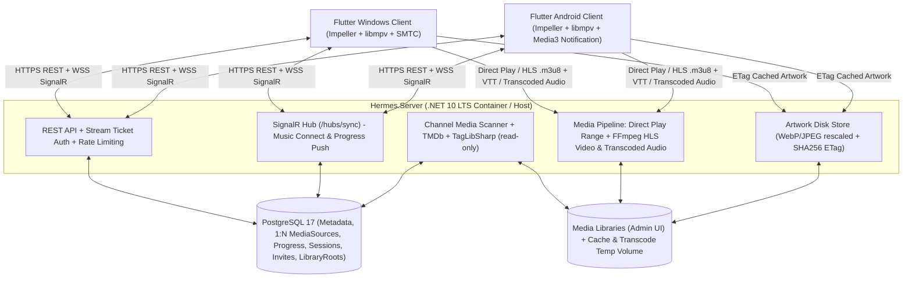

# Hermes Media Server — Technical Design Document

**Date:** 2026-11-15  
**Status:** Completed after Builder Check — approved for implementation  
**Target Repository Location:** `<repo-root>` *(folder without spaces for Flutter/Android NDK/Gradle compatibility; product name: **Hermes Media Server**)*  
**Spec Destination in Repo:** `docs/specs/2026-11-15-hermes-media-server-design.md`

---

## 1. Intent & Motivation

**Hermes Media Server** reinvents an earlier bachelor-thesis prototype (`<legacy-prototype-repo>`) — which suffered from secrets committed to Git, binary BLOBs inside EF Core, full-table scans in RAM, no native in-app video player, unstable cross-device sync, and duplicated MAUI code — into a **real, intuitive, enterprise-grade personal product**, built cleanly from scratch in a new public GitHub repository.

### Goals
1. **All-in-One Personal Media Hub (`Dual-World Hub: Cinema | Music`):**
   * **Cinema (Stremio / Nuvio style):** catalog with TMDb metadata + local fallback, *Continue Watching*, cross-device watch progress sync, seasons/episodes with automatic Next Episode, multi-source model per title (`1:N MediaSources` with a Stremio/Torrentio-inspired source selector and extensible foundation for future addons), YouTube-style video quality selector, audio/subtitle stream selection, and **native in-app video playback** (including a dedicated OpenGL HDR-safe profile for HDR monitors).
   * **Music (De-bloated Spotify):** fast library browsing, artists/albums, liked songs, personal playlists, live queue, Spotify Connect (*remote control by default + explicit output transfer*), Spotify-style audio quality selector (`Lossless` / `Very High` / `High` / `Medium` / `Low`), and native OS background playback (`MediaSession` on Android, `SMTC` on Windows).
2. **Secure LAN / Tailscale / Internet Access for Friends:** self-hosted server via `docker compose` (PostgreSQL + API + FFmpeg), Admin onboarding, invite codes, signed ephemeral stream tickets, and seamless failover between Remote/Tailscale URL and local LAN URL without re-login.
3. **Enterprise Showcase & Team Practices:** `.NET 10 LTS`, PostgreSQL, GitHub Actions CI/CD, strict static analysis, automated testing per PR (unit, `Testcontainers.PostgreSql`, multi-client `SignalR`, widget tests), and small vertical PRs with conventional commits.

### Non-Goals & Anti-Goals (v1)
* **NOT a glorified browser tab:** zero Electron, WebView, or Blazor Hybrid; native GPU-rendered client.
* **NO social features in v1:** no public/collaborative playlists or social feeds — focused strictly on a pure media server, cleanly modularized for future extensions.
* **NO per-user library permissions in v1:** every authenticated `Member` has universal read access across all enabled libraries.
* **NO legacy DB migration:** 100% clean PostgreSQL start + fresh scan from media folders (e.g., `<local-media-folder>` added by Admin from the UI).
* **NO spawning/killing `vlc.exe` processes on the server** and **NO live synchronized video watch parties** in v1 (only Watch Progress / Continue Watching sync on Cinema).
* **NO modifying user audio files:** library scanning is **strictly read-only**.
* **NO chaotic per-element UI customization:** clean personalization driven by semantic design tokens and presets.

---

## 2. Constraints

* **Legacy repo untouched:** `<legacy-prototype-repo>` remains an unmodified private thesis archive.
* **Workspace organization at execution:** create `Desktop\Projects\` and move existing repositories (`other-project-a`, `other-project-b`) alongside `hermes-media-server`, keeping a space-free folder name for the new project.
* **Zero secrets or personal paths in Git:** no TMDb API keys, JWT secrets, local paths (`<local-media-folder>`), IP addresses, or hardware serials may enter source code or committed configs. Any legacy TMDb key exposed in the old repo must be revoked by the owner.
* **v1 target platforms:** `.NET 10 LTS` backend + Flutter client for **Windows Desktop** and **Android Mobile** (architecturally ready for Android TV / Linux / macOS).
* **Tooling:** `.NET SDK 10.0.401+`, `Flutter SDK`, `Docker` + `PostgreSQL 17`, `FFmpeg`/`FFprobe`.

---

## 3. Approaches Evaluated

After ruling out WebView/Electron and fragmented MAUI codebases, three client approaches were evaluated on top of the `.NET 10 LTS + PostgreSQL` backend:

| Option | Client Stack | Pros | Trade-offs | Verdict |
| :--- | :--- | :--- | :--- | :--- |
| **1. Flutter + `media_kit` (`libmpv`)** *(Chosen)* | Dart + native Impeller/Skia + `media_kit` + `audio_service` / Windows SMTC | Proven by *Fladder* / *Nuvio* / *Spotube*. Native GPU rendering; video as a texture (zero HWND airspace over OSD/subtitles); direct `libmpv` control (including `OpenGL` renderer and dimmed HDR subtitles); MKV/H.265/ASS out-of-the-box; single Win + Android codebase. | Bilingual stack (C# backend + Dart client); requires Windows SMTC bridge and careful playback state coordination. | **Chosen** |
| **2. Avalonia UI 12 (`.NET 10`)** | Full-stack C# + `LibVLCSharp` (Win) + native `ExoPlayer` (Android) | Single C# language. | Official MediaPlayer requires commercial Pro license; `LibVLCSharp` on Windows suffers from **HWND airspace** over OSD controls; lacks unified out-of-the-box Android background media notifications. | Rejected |
| **3. Separate Native (`Compose + WinUI 3`)** | Kotlin + Jetpack Compose + Media3 (Android) & WinUI 3 (Windows) | Maximum OS-native fidelity. | Doubles UI, caching, and sync implementation effort across two completely separate codebases and languages. | Rejected |

---

## 4. System Architecture & Detailed Design

### 4.1 High-Level Topology

### 4.2 Monorepo Structure (`hermes-media-server`)
* `backend/`: `Hermes.slnx`, `Directory.Build.props` (`net10.0`, `Nullable=enable`, `TreatWarningsAsErrors=true`, `NuGetAudit=true`), `Directory.Packages.props` (Central Package Management), `.editorconfig`, **`src/Hermes.{Domain,Infrastructure,Api}` (Pragmatic DDD in `Domain` + `Ports/`, external adapters in `Infrastructure`, and Vertical Slices `Features/` in `Api`, without a redundant `Application` layer)** + `tests/Hermes.{UnitTests,IntegrationTests}` (`NetArchTest.Rules`, `Testcontainers.PostgreSql` + `WebApplicationFactory` + multi-client `HubConnection` sync tests). No `AutoMapper` and no `GenericRepository<T>`.
* `client/`: modular Flutter application (`lib/src/core`, `lib/src/features/{auth,shell,cinema,music,settings,admin}`, `test/`, strict `analysis_options.yaml`).
* `deploy/`: multi-stage `Dockerfile` with `ffmpeg` and non-root runtime user, `docker-compose.yml` (`hermes-api` + `postgres:17-alpine` + persistent volumes), `.env.example`, `appsettings.Example.json`.
* `.github/workflows/`: `ci-backend.yml`, `ci-client.yml`, `security.yml` (`dotnet list package --vulnerable`, Gitleaks, CodeQL), `docker.yml`.

### 4.3 Security, Onboarding, Friend Access & Multi-Endpoint Client
1. **First-Run Setup & Invite Codes:**
   * When no users exist, `/api/v1/setup` creates the initial `Admin` account and then permanently disables itself (`403/410`).
   * The Admin generates invite codes (with expiration and bounded `MaxUses`) for friends (`Member`). Open public registration is disabled by default.
2. **RBAC & Universal Library Access:**
   * `Admin`: configures `MediaLibraryRoots`, triggers scans, uses "Identify / Fix Match", generates invites, disables/deletes accounts, issues temporary one-time password reset codes (no SMTP required), and adjusts streaming limits (`ServerSettings`).
   * `Member`: universal read access to all active libraries, personal watchlist, watch progress, personal playlists, and liked songs. **Zero access** to server filesystem operations.
   * DTOs never expose other users' sensitive details; all endpoints outside auth/setup/health require `[Authorize]`.
3. **Multi-Device Auth, Multi-Endpoint Failover & Stream Tickets:**
   * `RefreshToken` stored per `(UserId, DeviceId, DeviceName)` — logging in on mobile does not sign out desktop; changing password revokes all device refresh tokens.
   * The client persists tokens securely and supports a **Primary URL (Remote / Tailscale HTTPS)** plus an optional **Local LAN Fallback URL** validated against the same `ServerId` (via `/api/v1/system/info`), switching transparently between home Wi-Fi and cellular without re-login.
   * Media streams, HLS playlists/segments, subtitles, and artwork use **ephemeral HMAC-SHA256 Stream Tickets** (`6h` media session / configurable TTL) — **never the primary bearer JWT in query strings**.
   * Native ASP.NET Core rate limiting on auth/setup/tickets endpoints.

### 4.4 PostgreSQL Database & Artwork Store
* **Real migrations:** controlled schema application via `Database.MigrateAsync()` (zero `EnsureCreatedAsync`).
* **1:N `MediaSource` Model (Stremio/Nuvio style):**
  * `Movie` and `Episode` store canonical metadata (title, year, overview, `TmdbId`, `ArtworkHash`, `BackdropHash`, `IsMetadataLocked`), while child table `MediaSources` holds one or more physical files (`FilePath`, `Container`, `VideoCodec`, `AudioCodec`, `Width`, `Height`, `IsHdr`, `BitrateBps`, `FileSizeBytes`, `SourceLabel` e.g. `1080p HEVC`, `MissingSince`) + `MediaStreams` (audio & subtitle tracks probed by `ffprobe`).
  * `WatchProgress` attaches to `Movie`/`Episode` so watch position stays shared across `1080p` and `4K` sources of the same title.
* **Zero `byte[]` BLOBs in SQL:** posters/covers/backdrops are processed at scan time via `SkiaSharp` into fixed WebP variants on disk/volume and served with `Cache-Control` + `ETag` (`304 Not Modified`).
* **100% PostgreSQL Search:** `GIN`/`pg_trgm` indexes, direct `.Select(...)` projections, zero full-table `.ToListAsync()` loads into RAM, and **zero concurrent `Task.WhenAll` calls on the same Scoped `DbContext`**.

### 4.5 Admin Library Roots, Scanner, TMDb Identify & FFmpeg Pipeline
* **Library Roots & `Channel<T>` Scanner:**
  * Admin-configured folders (`Movies`, `Series`, `Music`, optional FileWatcher). Checks `(FilePath, FileSizeBytes, LastWriteUtc)` in PostgreSQL **first** before invoking `ffprobe`, `TagLibSharp` (read-only inside `using`), or TMDb HTTP requests. Skips auxiliary folders (`Extras`, `Trailers`, `Sample`).
  * **Identify / Fix Match:** from a movie/series details view, Admin can manually search TMDb and re-bind title + artwork (locking `IsMetadataLocked = true` so subsequent scans never overwrite the manual choice).
* **Video Streaming (YouTube-style Quality Selector):**
  * Quality presets: **`Direct Play (Original)`**, **`1080p`**, **`720p`**, **`480p`**.
  * *Direct Play:* HTTP Range byte streaming (0% transcode CPU; native 4K/HDR/PGS/VobSub/ASS decoding in `libmpv`).
  * *On-Demand HLS Transcoding (FFmpeg):* `TranscodeSessionManager` launches seekable HLS (`libx264` + stereo `aac`, bounded by Admin concurrent transcode slot limits) with temporary segments cleaned up deterministically. Text subtitles (`.srt`, `.vtt`, embedded text tracks) are served as normalized `WEBVTT`; switching audio stream in transcode mode resumes from the current timestamp on the chosen track.
* **Audio Streaming (Spotify-style Quality Selector):**
  * Independently configurable presets for **Wi-Fi** and **Cellular / Mobile**: **`Lossless`**, **`Very High (320k)`**, **`High (160k)`**, **`Medium (96k)`**, **`Low (64k)`**.
  * **Zero-Upscale Rule:** when the source file bitrate is already `<=` the requested target bitrate (e.g., 128 kbps MP3 requested at *Very High 320k*), the server automatically falls back to **Direct Play** (`X-Hermes-Delivery: DirectPlay`) without running FFmpeg. FFmpeg transcodes audio only when the source exceeds the requested tier (`X-Hermes-Delivery: Transcoded`).

### 4.6 Cross-Device Synchronization — Deterministic Model
1. **Cinema (`WatchProgress`):** periodic ~10s heartbeats + immediate updates on Pause/Seek/Stop (with 90% auto-watched invariant); server pushes `WatchProgressUpdated` over SignalR to keep *Continue Watching* synchronized across connected devices.
2. **Music (Spotify Connect with Monotonic `Version`):**
   * Server maintains an atomic monotonic `long Version` per user session in `PlaybackConnectService` + an in-memory registry of online SignalR devices (`InMemoryDevicePresenceRegistry`).
   * **Remote Control by Default:** when Device A is `ActiveRendererDeviceId` and the user presses Play/Pause/Seek/Skip from Device B, the server updates the session and broadcasts to Device A — audio stays on A until the user explicitly selects **Transfer Output** in the Device Picker. If the active renderer disconnects completely, the session automatically transitions to `Paused` in PostgreSQL and clears `ActiveRendererDeviceId`.
   * **Single Client Coordinator:** `MusicPlaybackCoordinator` owns SignalR state reconciliation and ignores any incoming update with `Version <= lastAppliedVersion`, eliminating duplicate subscribers and seek feedback loops.

### 4.7 Client UI/UX (`Flutter` — Dual-World Hub, Token Customization & HDR Subtitle Fix)
* **Dual-World Hub (`Cinema | Music`):** top-level switch separating two focused experiences:
  * **Cinema:** Stremio/Nuvio-inspired layout (Hero backdrop, *Continue Watching*, *Movies*, *Series*, source/resolution selector per title, *Identify* for Admins, GPU OSD with quality/audio/subtitle selectors, **OpenGL HDR renderer preset**).
  * **Music:** clean Spotify-style interface (Home, Search, Artists/Albums, Liked Songs, Playlists, Queue, Connect Device Picker for remote control vs explicit handoff, Wi-Fi/Cellular audio quality settings, persistent Mini-Player).
* **Token-Based Customization (`HermesThemeTokens`):**
  * Default preset: **`Obsidian Glow + Accent Crimson`** (`#090B12` primary, `#111522` elevated, `#E11D48` Crimson accent).
  * User presets: **Surface** (`Obsidian Glow` / `OLED Black` / `Slate`) + **Accent** (`Crimson`, `Violet`, `Emerald`, `Amber`, `Cyan`, `Dynamic Album Art`).
* **Video Renderer & HDR Monitor Protection:**
  * *Player Preferences* exposes **Video Renderer** (`OpenGL (HDR Safe)` / `Auto (System)`) and applies `gpu-api=opengl`, `#D8D8D8` dimmed off-white subtitle color, and `#80000000` subtitle background to prevent SDR subtitle luminance blooming on HDR monitors.

---

## 5. Standard Engineering Decisions

1. **Global Transcode Slot Limits:** `MaxConcurrentVideoTranscodes` (default `2`) and `MaxConcurrentAudioTranscodes` prevent host saturation (returning HTTP `429 transcode_slots_exhausted` when full).
2. **HLS Video Codec & Subtitles:** v1 HLS video transcoding uses universal CPU `libx264` + `aac` (working cleanly in any Docker host without GPU passthrough; hardware NVENC/VAAPI/QSV remains a clean future extension). External `.srt`/`.vtt` and embedded text tracks normalize to `WEBVTT`, while bitmap subtitles (`PGS`/`VobSub`) play natively in Direct Play via `libmpv`.
3. **Zero-SMTP Account Recovery:** Admins can deactivate/delete `Member` accounts and issue temporary one-time password reset codes directly from the Admin UI.
4. **Native Media Controls:** `PlatformMediaBridge` integrates transport controls with OS media keys and notifications.

---

## 6. Structured PR Roadmap (10 Vertical Slices)

1. **PR 1 — Repo Foundation, Tooling & CI:** `.slnx`, `Directory.Build.props`, `Directory.Packages.props`, `.editorconfig`, `Dockerfile` (with `ffmpeg`) + `docker-compose.yml` (`Postgres 17`), `.env.example`, `.github/workflows/` CI/Security.
2. **PR 2 — Domain, PostgreSQL Schema (`1:N MediaSources`) & Migrations:** zero-BLOB entities, `ServerSettings`, `pg_trgm` indexes, initial EF Core migrations + `Testcontainers.PostgreSql` tests.
3. **PR 3 — Auth, First-Run Setup, Invites, Multi-Endpoint Info & Stream Tickets:** `/setup`, invite codes, RBAC, `/system/info` (`ServerId`), per-device `RefreshToken`, HMAC stream tickets + security integration tests.
4. **PR 4 — Admin Library Roots, Async Read-Only Scanner, TMDb Identify & Artwork Store:** CRUD `MediaLibraryRoots`, `Channel<T>` + `ffprobe` + read-only `TagLibSharp` + TMDb DB-first caching + manual Identify + `SkiaSharp` WebP/ETag + tests.
5. **PR 5 — Streaming Pipeline (Direct Play + FFmpeg HLS Video/Audio + Subtitles) & Watch Progress API:** HTTP Range, `TranscodeSessionManager` (bounded slots & YouTube/Spotify bitrate tiers), `.vtt` subtitles, `WatchProgress` + pipeline/Range/VTT tests.
6. **PR 6 — Music Catalog, Playlists & SignalR v2 Monotonic Sync:** native SQL/`pg_trgm` search, Playlists/Likes, `PlaybackConnectService` + `PlaybackSyncHub` with monotonic `Version`, remote control by default, output transfer, and multi-client `HubConnection` tests.
7. **PR 7 — Flutter Foundation, Multi-Endpoint Auth & `Obsidian Crimson` Theme Engine:** Win/Android setup, `EndpointResolver` primary/LAN failover, `HermesThemeTokens`, `DualWorldShell` (`Cinema | Music`) + widget tests.
8. **PR 8 — Flutter Cinema Experience, Source Picker, `media_kit` Config & Admin UI:** Cinema catalog, multi-source selector (`1:N`), quality/audio/subtitle UI, **OpenGL HDR-safe renderer preset**, Admin Dashboard (Libraries, Invites, Users) + tests.
9. **PR 9 — Flutter Music Experience, Quality Policy, Platform Media Bridge & Connect Sync:** Music catalog/playlists, `MusicPlaybackCoordinator`, `DevicePickerSheet`, Wi-Fi/Cellular audio quality selector, `MiniPlayerBar` + coordinator/widget tests.
10. **PR 10 — Showcase Polish, Full-Stack E2E Smoke Test & Portfolio Docs:** `FullStackSmokeTests` (FFmpeg synthetic media -> setup -> scan -> stream -> transcode -> search -> SignalR Connect), `README.md`, `docs/ARCHITECTURE.md`, `docs/CONTRIBUTING.md`, `docs/SECURITY.md`, `.github/pull_request_template.md`.
